# Intranet MUPA

The new intranet for the Municipality of Panama City (Alcaldía de Panamá): a React web app and an Express API with PostgreSQL, in a single repository. The interface is in Spanish, because it is used by the Municipality's staff.

> **Sanitized copy of the Municipality's private repository; history condensed.** It contains no keys, internal addresses or personal data: the staff directory and the clinic staff are fictitious, and all accounts are test accounts. Everything that needs a key from the Municipality is listed under [Limitations of this copy](#limitations-of-this-copy).

## Try it

With Docker (Compose v2), without creating any file:

```bash
docker compose up --build      # → http://localhost:8080
```

Without Docker, with Node 22.18 or newer (no PostgreSQL needed: the API uses PGlite):

```bash
npm run demo                   # → http://localhost:5173
```

If port 8080 is taken: `WEB_PORT=8090 docker compose up --build`. If 3000 or 5173 are taken: `DEMO_PUERTO_API=3010 DEMO_PUERTO_WEB=5180 npm run demo`.

Both start the `completa` (full) edition with seed data (applications, documents, newsletters, sample forms) and these fictitious accounts. The password for all of them is `password`:

| Account | Role | What it sees |
|---|---|---|
| `prueba1@ejemplo.test` | User | Home, Applications, Directory, Documents, News, forms and their own requests. |
| `prueba2@ejemplo.test` | User | The same, as a different person (useful to check that nobody sees someone else's requests). |
| `gestor@ejemplo.test` | Request Manager | Also the Management Center, the request inbox and the form builder. |
| `comunicacion@ejemplo.test` | Communications | Also publishes news, newsletters, videos and the Home page content. |
| `admin@ejemplo.test` | Administration | Everything, plus users, departments and the application catalog. |

`sindepto@ejemplo.test` is an account without a department: after signing in, it is asked to choose one.

To start over: `docker compose down -v` (deletes the Docker database) or delete `mupa-intranet-api/.data/demo` (the one used by `npm run demo`).

## Limitations of this copy

The intranet connects to Municipality systems that only answer inside its network and with a key. Those keys are not in this copy. Where one is missing, the web app shows a short notice instead of an error or an empty screen.

| Integration | Status |
|---|---|
| Signing in with the fictitious accounts | Works locally |
| Customizable Home, Applications, Directory, Documents, News, Newsletters and Visual identity | Works locally |
| Forms, form builder, requests and the request inbox | Works locally |
| Management Center (metrics, charts and recent activity) and audit log | Works locally |
| Live notifications to managers (SSE) | Works locally |
| Real sign-in with Identity Central (the Municipality's account) | Requires a key (not included) |
| Creating an account (Identity Central and RH Link) | Requires a key (not included) |
| RH Link check at sign-in (active employee and their department) | Requires a key (not included) |
| RRHH Express: clock-ins, compensatory time, pay slips and personnel file | Requires a key (not included) |
| Clinic appointments («Mis citas») | Requires a key (not included) |
| Phone call codes and Help Desk tickets (GLPI) in «Mis solicitudes» | Requires a key (not included) |
| Assistant (language model server, `LLM_URL`) | Requires a key (not included) |
| Directory from the phone system (PBX) | Requires a key (not included); locally it uses the fictitious static directory |
| News and newsletters synced automatically from mupa.gob.pa | Turned off in this copy (`WP_SYNC_URL` empty): the news in the screenshots are samples |
| Email notifications | Pending the Municipality's mail server |

Also:

- The brand typefaces, Noka and Prometo, are licensed and not included in this copy. Everything uses Montserrat, which is free (OFL).
- The logos, brand manual, PDF documents and newsletters are the ones the Municipality already publishes.

## Demonstrated functionality

Screenshots taken with Playwright on this copy, at 1440 × 900, with the fictitious accounts and sample data. To retake them: start the intranet and run `node docs/screenshots/tomar-capturas.mjs` (see [the script](docs/screenshots/tomar-capturas.mjs)).

**Customizable Home**

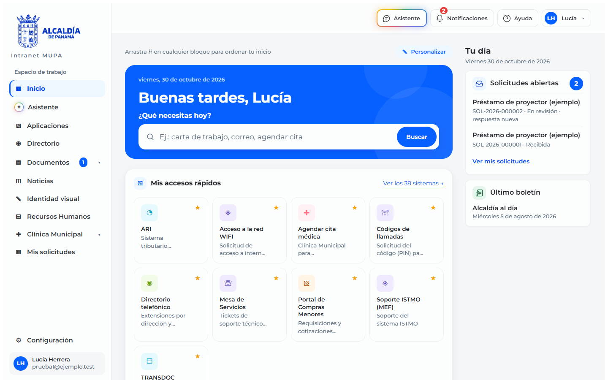
*A person's Home page (User role): search, quick links and «Tu día» (Your day) with their open requests.*

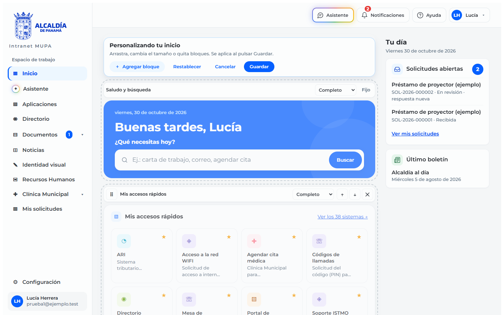
*«Personalizar» (Customize) mode (User role): each block can be moved, resized or removed, and the layout is saved for that person.*

**Applications**

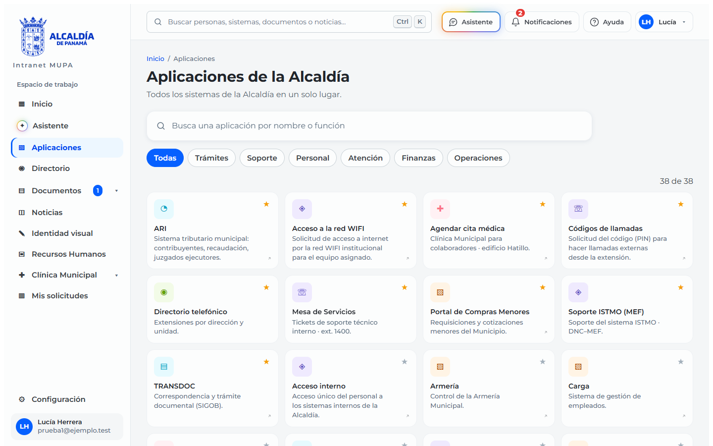
*The catalog of the Municipality's systems, with search and a filter by area (User role).*

**Directory**

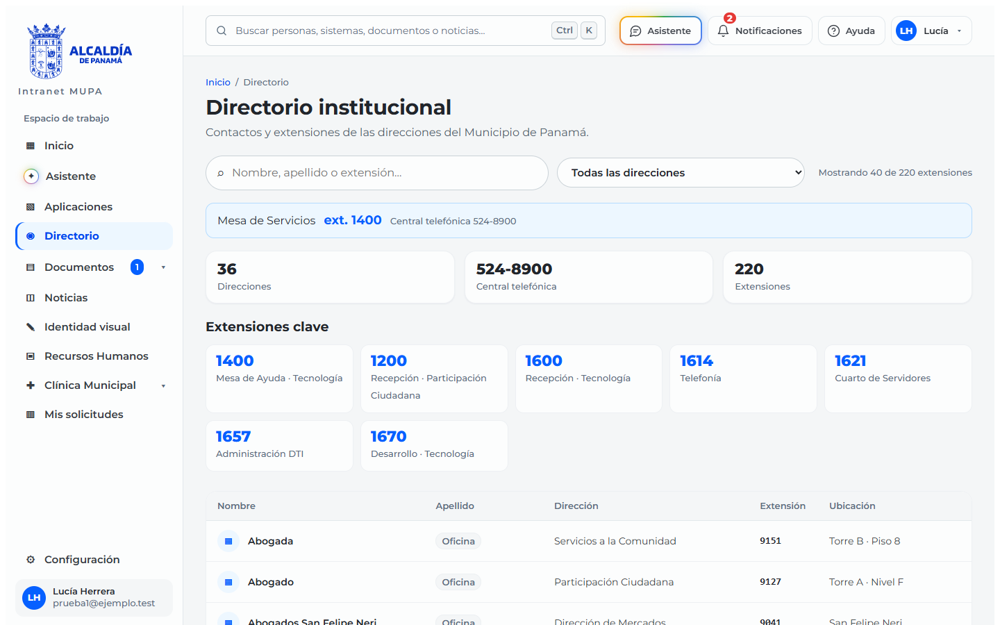
*The staff directory with search and key extensions (User role); the people in this copy are fictitious.*

**Documents**

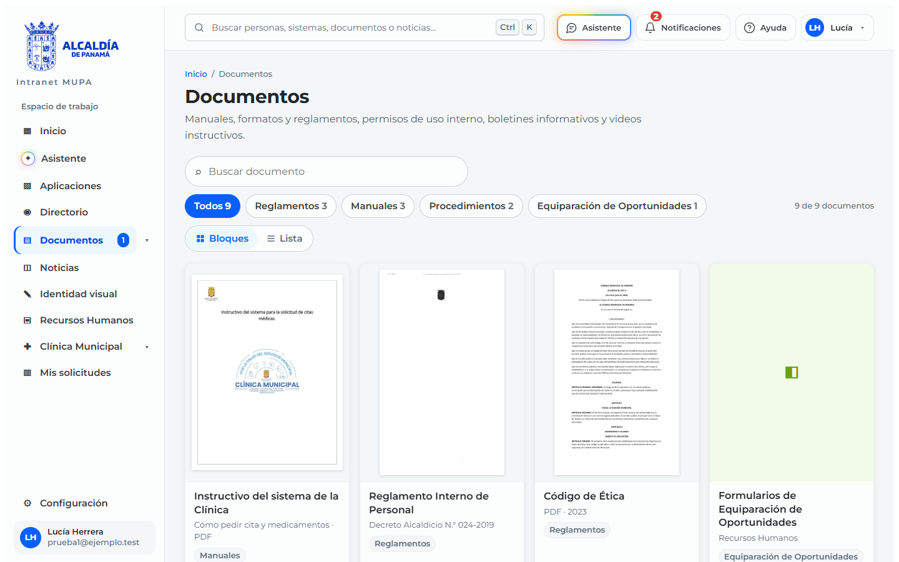
*Regulations, manuals and procedures in grid view, showing the first page of each PDF (User role).*

**News**

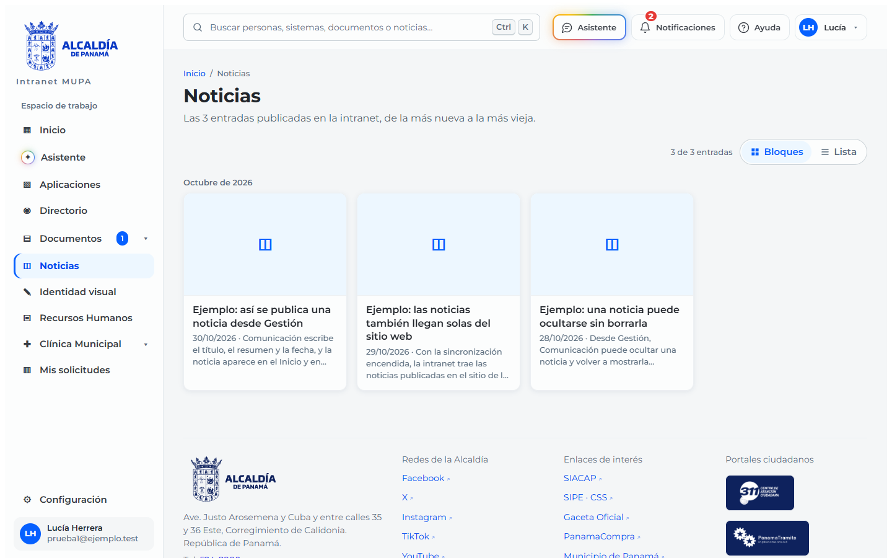
*News published from the management area; all three are samples (User role).*

**Form builder**

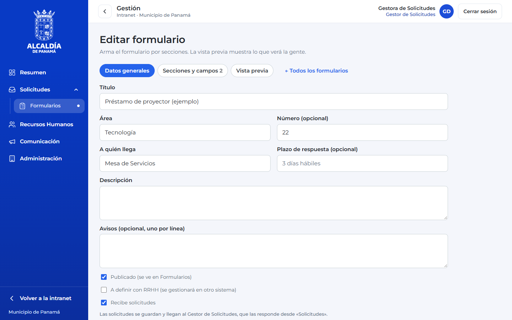
*The form builder: general details, sections and fields, preview, and the «Recibe solicitudes» (Accepts requests) switch (Request Manager role).*

**My requests**

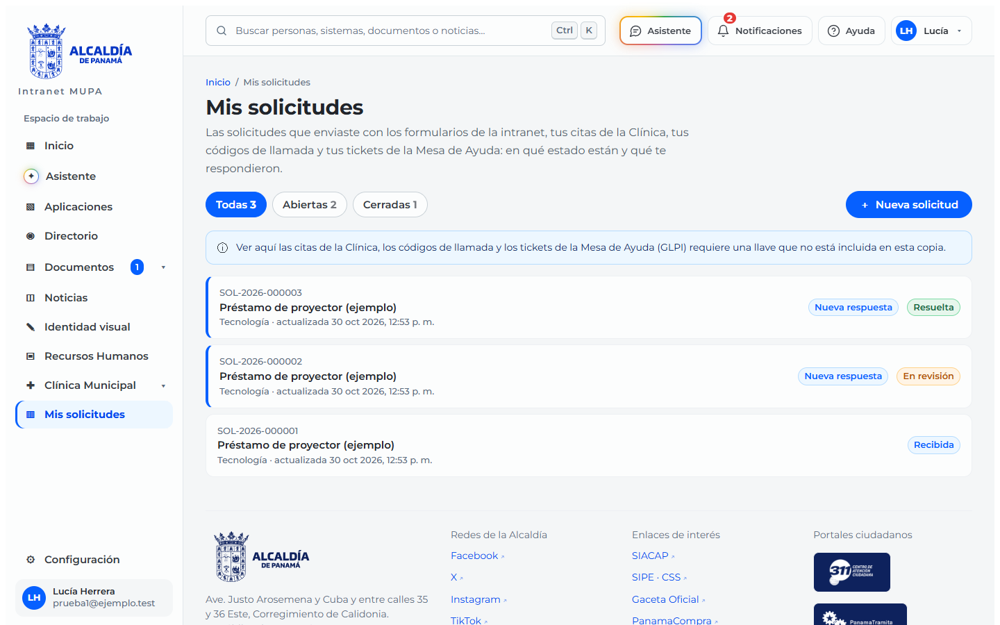
*A person's requests in their three states, Received, In review and Resolved, with the new-reply badge (User role).*

**Management Center**

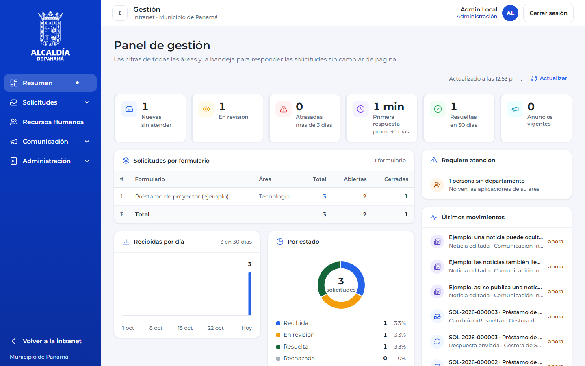
*The Management Center with metrics, charts and recent activity (Administration role); its menu includes Administration.*

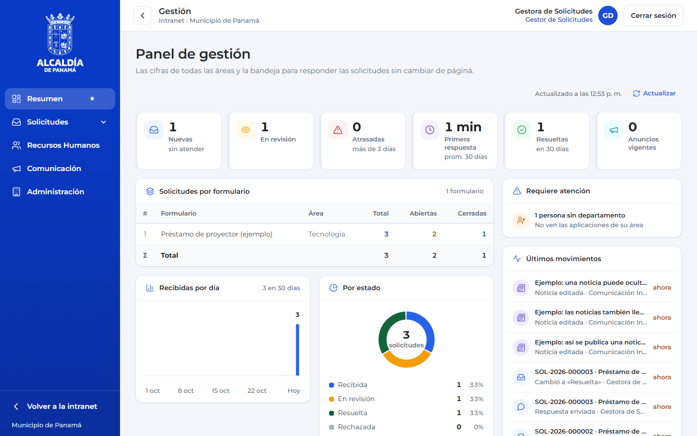
*The same dashboard for the Request Manager role; its menu opens Requests and Forms.*


*The dashboard for the Communications role; for now every manager sees every area, and its menu opens Communications.*

**Live notification**

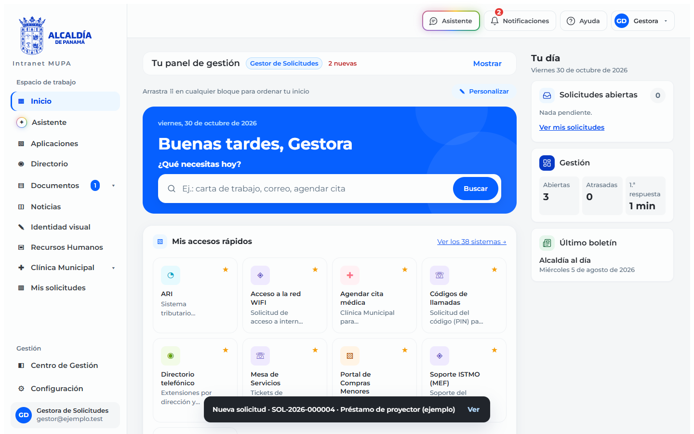
*The request manager gets «Nueva solicitud» (New request) as soon as a person submits one, without reloading the page (Request Manager role).*

**Assistant**

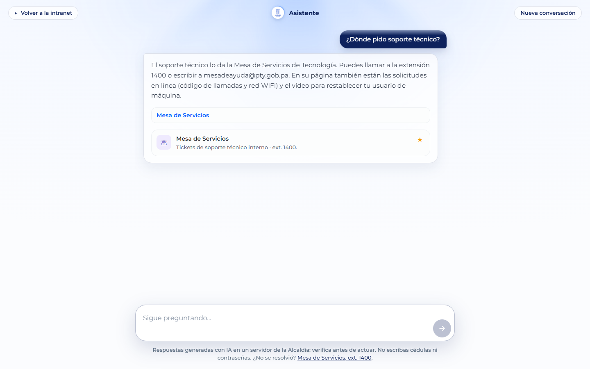
*The assistant answers with the extension, the email address and a link to the right page (User role). The answer is a sample: the language model is not included in this copy.*

## Structure

| Folder | What it is |
|---|---|
| `mupa-intranet-app/` | Web app: SPA in React + Vite + React Router. All API calls are in `src/api.ts`. |
| `mupa-intranet-api/` | API: Express + Drizzle + Zod + PostgreSQL, organized by feature (`src/features/`). Its conventions are in its `CONVENTIONS.md`. |
| `mupa-intranet-mcp/` | MCP server (Python + FastAPI) with the catalog of endpoints and pages used by the assistant. |
| `docker-compose.yml` | PostgreSQL, then migrations and seed data, then the API (which also serves the web app) and the MCP server. |
| `docker-compose.dev.yml` | The same, against an external database. |
| `docs/screenshots/` | The screenshots above and the script that takes them. |

The web app and the API come in two editions (`EDICION`): `completa`, the one in this demo, and `publicacion`, the one published at the Municipality, with some features turned off (`mupa-intranet-app/src/lib/edicion.ts`).

The code, comments and internal docs are in Spanish, the working language of the project.

## Tests

```bash
cd mupa-intranet-api && npm test                 # API: vitest against an in-memory PGlite database
cd mupa-intranet-app && npm run typecheck && npm run lint && npm run test:int
cd mupa-intranet-app && npm run test:e2e         # Playwright: starts its own API and web app
```

## Docker in more detail

Startup order (each service waits for the previous one):

1. **db:** `postgres:17-alpine` with a healthcheck and the data in the `pgdata` volume.
2. **migrate:** applies the Drizzle migrations and loads any missing seed data. If it fails, the API does not start.
3. **api:** the only custom image. Its Dockerfile also builds the web app, and the API serves it on `WEB_PORT` (8080 by default) together with `/api/`.
4. **mcp:** the assistant's MCP server, reachable only inside the Docker network.

Without a `.env` file, Compose uses the local demo values. To change them: `cp .env.example .env`. A real server uses `NODE_ENV=production`, and then the API refuses to start with the fictitious accounts.

```bash
docker compose logs -f api            # follow the API logs
docker compose run --rm migrate       # rerun migrations and seed data
docker compose down                   # stop (data stays in the volume)
docker compose down -v                # stop and delete the database
```

New migrations: change the schema in `mupa-intranet-api/src/database/schema`, run `npm run db:generate -- --name what-changes`, and the next `docker compose up --build` applies them.

`scripts/respaldo.sh` backs up the database and the uploaded files (`uploads` volume); the restore commands are at the top of the script.
